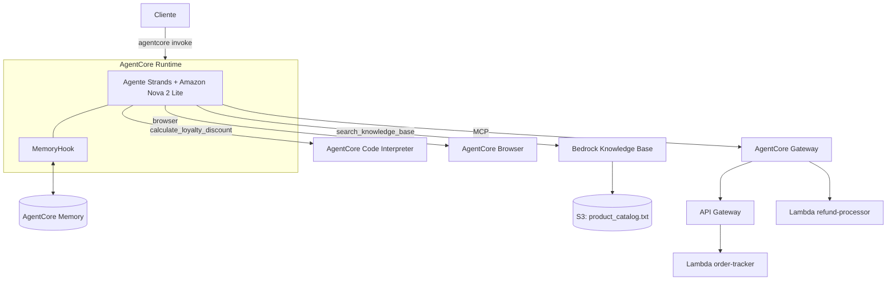

# Agente de suporte ao cliente com Amazon Bedrock AgentCore

Agente de IA para uma loja fictícia, implantado no AgentCore Runtime. Ele rastreia pedidos, processa reembolsos, responde com base em uma Knowledge Base, lembra do cliente entre sessões, calcula descontos em um sandbox e navega na web.

Os seis cenários de teste foram executados contra o agente implantado. Depois da verificação, os recursos do agente foram removidos, então as evidências ficam em [`evidence/`](evidence/).

## Contexto

Projeto do segundo curso da formação de engenharia de agentes de IA na AWS da Udacity. Parte de um [código inicial com TODOs](https://github.com/udacity/cd14763-project-starter), e as Lambdas de pedidos e reembolsos vêm prontas. Implementei o agente em `main.py`, montei a infraestrutura na AWS e resolvi os problemas que apareceram no deploy.

O objetivo foi sair de um chatbot local e chegar a um agente implantado, com ferramentas externas, RAG, memória de longo prazo e execução segura de código.

## Arquitetura



| Componente | Função |
| --- | --- |
| **AgentCore Runtime** | Hospeda o agente em uma imagem de contêiner ARM64 publicada no ECR. |
| **Strands Agents + Nova 2 Lite** | Fazem o loop do agente com o modelo `global.amazon.nova-2-lite-v1:0`. |
| **AgentCore Gateway (MCP)** | Expõe os dois backends como ferramentas. |
| **`order-tracker`** | Consulta pedidos e clientes por uma API REST no API Gateway. |
| **`refund-processor`** | Inicia reembolsos, consulta o status e gera etiquetas de devolução, com invocação direta da Lambda. |
| **Bedrock Knowledge Base** | Faz o RAG sobre produtos, políticas e programa de fidelidade. |
| **AgentCore Memory** | Guarda fatos e preferências de cada cliente. |
| **Code Interpreter** | Executa o cálculo de desconto em um sandbox, com cálculo reduzido caso fique indisponível. |
| **AgentCore Browser** | Busca informações em páginas da web. |

### Decisões de design

- **Memória por cliente:** o `MemoryHook` usa `customer_id` como ator, não a sessão. É isso que permite lembrar do cliente em uma sessão nova.
- **Contexto antes de cada mensagem:** o hook busca até 5 registros por namespace e os adiciona à mensagem como `Customer Context`. Depois da resposta, salva o turno para extração de fatos.
- **Mesmo formato de retorno no desconto:** o Code Interpreter e o fallback devolvem as mesmas chaves JSON. O fallback aplica só o desconto do nível e indica isso em `fallback_used`.
- **Respostas baseadas em ferramentas:** o system prompt proíbe inventar dados de pedidos, reembolsos ou políticas.

## Resultados

| Teste | Resultado | Evidência |
| --- | --- | --- |
| Rastreio de pedido | ORD-001 enviado pela UPS, com rastreio e previsão de entrega | [captura](evidence/test_1.png) |
| Reembolso | Reembolso de US$ 139,99 aprovado, com ID e prazo de 3 a 5 dias úteis | [captura](evidence/test_2.png) |
| RAG | Benefícios do nível Platinum recuperados da Knowledge Base | [captura](evidence/test_3.png) |
| Memória | Uma sessão nova lembra o nome e a preferência do cliente | [captura](evidence/test_4.png) |
| Desconto | 4.000 pontos resgatados, US$ 11 de desconto Gold, total de US$ 99 | [captura](evidence/test_5.png) |
| Navegador | Título de uma página obtido ao vivo | [captura](evidence/test_6.png) |

A saída completa está em [`evidence/test_results.txt`](evidence/test_results.txt), e a reflexão sobre o projeto em [`evidence/reflection.txt`](evidence/reflection.txt).

### Problemas resolvidos no deploy

- **Build bloqueado:** a conta de laboratório não permitia containers privilegiados no CodeBuild. Fiz o build local da imagem ARM64 com WSL2 e Docker usando `agentcore deploy --local-build`.
- **Reembolsos falhando em silêncio:** o alvo do Gateway ainda tinha um schema `DefaultTool` provisório, e o modelo encobria a falha com respostas inventadas. Os logs mostraram a causa, e apliquei o schema real de `lambda/lambda_schema`.
- **Memória contaminada:** dados inventados tinham sido salvos como fatos. Apaguei esses registros e reforcei as regras do system prompt.
- **Permissões faltando:** o papel de execução gerado não tinha `bedrock:Retrieve` nem acesso ao navegador. Adicionei os dois, limitados aos recursos necessários.

## Estrutura

```text
├── main.py                    agente, hook de memória e ferramentas
├── lambda/
│   ├── order_tracker.py       API de pedidos e clientes
│   ├── refund_processor.py    reembolsos e etiquetas de devolução
│   └── lambda_schema          schema das ferramentas no Gateway
├── product_catalog.txt        documento da Knowledge Base
├── pyproject.toml, uv.lock    dependências
├── .env.example               variáveis necessárias
└── evidence/                  capturas, saída dos testes e reflexão
```

## Como executar

Pré-requisitos: conta AWS com acesso ao Bedrock e ao AgentCore, AWS CLI v2, Python 3.14+, [uv](https://docs.astral.sh/uv/) e o modelo Amazon Nova 2 Lite habilitado. Use a região `us-east-1`.

1. Implante as duas Lambdas de `lambda/`. Exponha `order-tracker` pelo API Gateway com as rotas `GET /orders/{order_id}`, `GET /customers/{customer_id}/orders` e `GET /customers/{customer_id}`.
2. Crie um AgentCore Gateway com os dois alvos, usando `lambda/lambda_schema` no `refund-processor`.
3. Crie uma Knowledge Base a partir de `product_catalog.txt`, com Titan Embeddings v2.
4. Crie um recurso AgentCore Memory com as estratégias semântica (`cs_agent/{actorId}/facts`) e de preferências (`cs_agent/{actorId}/preferences`).
5. Copie as variáveis e preencha com os seus valores:

   ```bash
   cp .env.example .env
   set -a; source .env; set +a
   uv sync
   ```

6. Implante e teste:

   ```bash
   agentcore configure --entrypoint main.py --name customer_support_agent
   agentcore deploy --env GATEWAY_URL="$GATEWAY_URL" --env KB_ID="$KB_ID" --env MEMORY_ID="$MEMORY_ID"
   agentcore invoke '{"prompt": "Can you track order ORD-001?", "customer_id": "CUST-123", "session_id": "t1"}'
   ```

Para remover o agente depois, use `agentcore destroy`.

## Limitações

- O Gateway não tem autorizador, então qualquer pessoa com a URL pode chamar as ferramentas. Isso só é aceitável em um laboratório de curta duração.
- O `customer_id` vem do payload sem verificação de identidade.
- A conversão de 100 pontos para US$ 1 é uma suposição, porque o enunciado não definia a taxa.
- Para produção, seriam necessários autenticação no Gateway, limites e aprovação para reembolsos, memória só com fatos verificados e infraestrutura como código.

## Licença

Projeto educacional baseado em material da Udacity, sujeito aos termos de [LICENSE.txt](LICENSE.txt).
